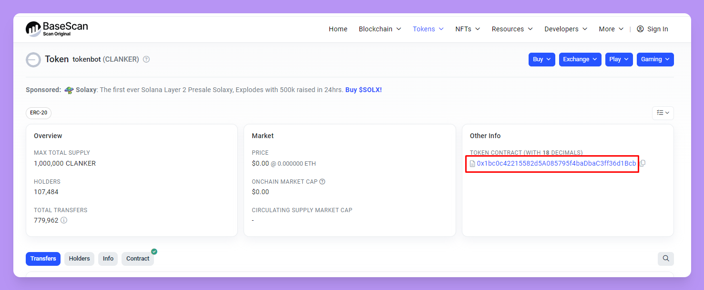
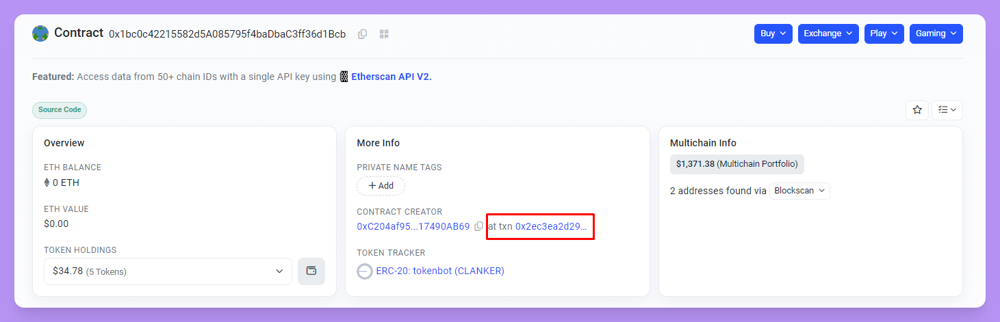
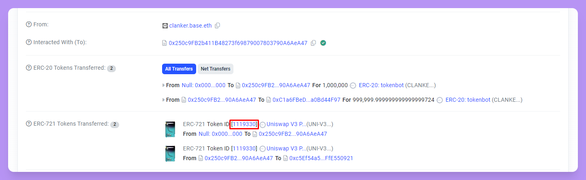

# Unclaimed Rewards Balance

Once a token you deployed with Clanker has been traded at least once, it has earned rewards. This page shows how to check what you can claim.

## Clanker v5

### How it works

v5 rewards collect in the FeeEscrow, one balance per recipient and currency (ETH or USDC). A recipient's balance includes the rewards of all v5 tokens that pay that wallet, and one claim pays all of it, so claiming on one token also clears the balance shown on the recipient's other v5 tokens.

### Example

A wallet is the reward recipient of two ETH-paired v5 tokens. Token A has earned 0.3 ETH and token B 0.2 ETH since the last claim.

| Step                          | Amount  | Calculation |
| ----------------------------- | ------- | ----------- |
| Balance shown on either token | 0.5 ETH | 0.3 + 0.2   |
| Paid by one claim             | 0.5 ETH | All of it   |
| Balance after the claim       | 0 ETH   | On both     |

### Check on clanker.world

1. Open the token's Admin page: `https://www.clanker.world/clanker/TOKEN_CONTRACT_ADDRESS_HERE/admin`.
2. The **Claim Rewards** card shows the unclaimed balance of the selected reward recipient, in the pair token.

A past recipient keeps its unclaimed balance. Connect that wallet and check the **Tax Fees** card on your [clanker.world profile](https://www.clanker.world/profile).

### With the API

`GET /api/creator-earnings/{tokenAddress}` returns the unclaimed FeeEscrow balances of the token's current reward recipients. See [Creators](../api-reference/public/creators.md).

### Related

* [Creator Rewards & Fees](creator-rewards-and-fees.md) for how rewards are earned and claimed.
* [Managing a Token](managing-a-token.md) for the Admin page.

## Clanker v4 and earlier

The token page on clanker.world shows an estimate of unclaimed rewards near the bottom. For a token whose initial LP is a Uniswap v3 position, you can also check the `Uncollected fees` of that position on chain:



### Open the token on BaseScan

Go to your token's page on [clanker.world](https://www.clanker.world/) and select `BaseScan`.

<figure><figcaption></figcaption></figure>



### Open the token contract

Click the contract address of the token.

<figure><figcaption></figcaption></figure>



### Open the creation transaction

Click the contract creation transaction.

<figure><figcaption></figcaption></figure>



### Find the LP token ID

Note the `Token ID` of the LP position.

<figure><figcaption></figcaption></figure>



### Open the position on Uniswap

Visit `https://app.uniswap.org/positions/v3/base/YOUR_TOKEN_ID`, with your `Token ID` in place of `YOUR_TOKEN_ID` (for example, [this position](https://app.uniswap.org/positions/v3/base/1119330)).



### Work out the creator's part

40% of the `Uncollected fees` is the creator's unclaimed rewards. Dollar values are estimates and move with the prices of the two tokens in the pool.

<figure><figcaption></figcaption></figure>



For the $CLANKER position in the screenshot:

| Token    | Uncollected fees | Creator's part (40%) |
| -------- | ---------------- | -------------------- |
| $CLANKER | 148.28           | \~59.312             |
| $WETH    | 3.73             | \~1.492              |

See the [FAQ](faq.md) for claiming creator rewards.
