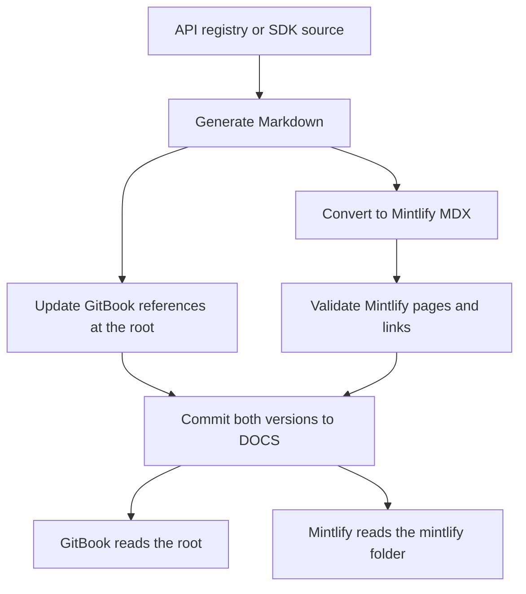

# GitBook and Mintlify

## Repository layout

```text
DOCS/
  README.md                 GitBook introduction
  SUMMARY.md                GitBook navigation
  .gitbook.yaml             GitBook configuration
  .gitbook/assets/          Original images and PDFs
  general/                  Original Markdown guides
  droids/
  api-reference/
  sdk-reference/
  references/
  mintlify/                 Separate Mintlify site
    docs.json
    index.mdx
    general/
    droids/
    api-reference/
    sdk-reference/
    references/
    assets/
    scripts/
    migration/
    package.json
```

The migration preserves all original GitBook files in place. Mintlify has copies of the images and PDFs, converted MDX pages, its own navigation and the existing blue theme. Neither site needs to replace the other or move to a legacy branch.

GitBook continues to use the root `README.md`, `SUMMARY.md` and `.gitbook.yaml`. Mintlify uses `mintlify/docs.json`; select `mintlify` as its source directory in the dashboard. Its published page paths remain unchanged by the folder move.

## Content

All 86 published pages are represented: introduction, guides, Droids, API, SDK and contract references. The original 6 audit PDFs and 11 images remain unchanged and have identical copies for Mintlify.

The Mintlify audit page opens the reports in Google Drive because PDF serving requires Mintlify Enterprise. The six reports are in the [Clanker Drive folder](https://drive.google.com/drive/folders/1f0KVQ0da1oFfe1_aWcqfN5aUR4OPynXN), with anyone-with-the-link viewer access. `migration/audit-links.json` maps the original filenames to their public report links, so guide sync preserves them. When adding an audit, upload the PDF, verify its public access, add its mapping and run guide sync. GitBook continues to use its original PDF files.

GitBook hints, expandable sections and step lists become Mintlify callouts, accordions and steps. Brand embeds link to the original Figma and Drive resources. Existing paths are preserved or redirected; the SDK index uses `core-utilities` to avoid a nested index route conflict.

Large generated SDK declarations remain complete in linked text files under `assets/sdk-types/`, served through GitHub's raw file URLs instead of Mintlify. Code blocks over 200 lines and type/table values over 2,000 characters use this presentation to keep the pages usable. Short examples stay inline. These generated files belong only to the Mintlify site. Downloads use the same DOCS branch as the SDK publishing job; local imports use `DOCS_BRANCH` or the current branch. New or changed files become available after that branch is pushed.

Older generated text files are retained so previously shared download links keep working while their GitHub branch remains available. The SDK asset manifest lists the files referenced by the current pages. Before deleting the preview branch, regenerate and verify the links on `main`; any links shared directly from the deleted branch will need updating.

The converter retains the previously reviewed link repairs for ClankerToken, creator search, FAQ anchors and a legacy SDK claim type. Generated references follow current API/SDK source, which can be newer than the checked-in GitBook snapshot. Regeneration can therefore update reference content in both versions.

## Keeping both versions current



The API and SDK workflows always retain their existing GitBook copy steps. If `mintlify/scripts/import-generated.mjs` exists in the selected DOCS branch, they also install its locked dependencies, convert the same generated Markdown and validate the Mintlify site before committing. A failed conversion or validation prevents the commit and push step.

`DOCS_BRANCH` selects an existing branch in the DOCS repository and defaults to `main`. It does not select a folder or change the application deployment branch. Keep both generators targeting the same intended DOCS branch. Before the Mintlify folder is merged, the workflows continue updating GitBook alone.

Both publishing jobs check that `DOCS_PAT` is present and its account has push permission before generating files. The credential also needs Contents read/write permission for `clanker-devco/DOCS`, organization authorization where required, and access permitted by the destination branch rules. This initial check does not prove token scopes or branch-rule compatibility; a successful authorized publishing run is still required. Personal GitHub access and this automation credential are separate.

For handwritten guides, continue editing the original GitBook Markdown and run `npm run sync:guides` from `mintlify/`. This refreshes the corresponding MDX and copied assets without modifying GitBook, generated references, navigation or theme. CI detects unsynced guide changes in pull requests. GitBook dashboard edits must also be synced into Mintlify before publishing the corresponding update; they do not automatically run this local command. Add or remove pages in both navigations and the migration page mapping.

Run API and SDK publishing jobs sequentially during the transition. Both use the existing direct Git push mechanism; simultaneous jobs can cause a non-fast-forward rejection. Check and rerun a rejected job after the other completes; do not force-push.

## Local work

| Repository | Branch | Change |
| --- | --- | --- |
| DOCS | docs/migrate-to-mintlify | Add the Mintlify folder and validation while preserving GitBook |
| clanker.world | ci/mintlify-api-docs | Update GitBook and optionally Mintlify API references |
| clanker-sdk | ci/mintlify-sdk-docs | Update GitBook and optionally Mintlify SDK references |

Use the existing root checkouts. See [README.md](README.md) for commands. No application environment files or hosted services are required to generate and preview documentation.

## Review and release

1. Validate locally and compare the GitBook files against the base branch. Review guides, API/SDK pages, images, PDF downloads and redirects.
2. Publish the DOCS feature branch when approved. Connect Mintlify to that branch with source directory `mintlify` and review its provided URL. Leave GitBook connected to its existing branch and root.
3. Confirm hosted search, mobile layout, SDK loading performance and links. Check GitBook-only unpublished content, integrations, analytics and access settings separately.
4. Merge the revised API and SDK workflow PRs one at a time and check their runs. They still update GitBook if the destination does not yet contain Mintlify. The clanker.world main merge also triggers its normal Vercel Production build.
5. Merge the additive DOCS changes after review. GitBook keeps its original files. Keep the existing Mintlify branch until the generated references on `main` have been refreshed.
6. Run the API and SDK documentation jobs sequentially against `main`. The SDK job also updates the raw download links to `main`. Point Mintlify to `main`, still using the `mintlify` directory, and confirm both output formats and both hosted sites. Verify that GitBook's sync continues to use the existing navigation without importing the Mintlify folder. Keep the preview branch until this is complete.
7. Change the public docs domain or the application's `/docs` route only when ready. Keep the existing GitBook route until the Mintlify domain or proxy has been tested.
8. Retire GitBook only through a separate, deliberate cleanup after the team decides to do so.

Local checks do not prove hosted Git Sync, Mintlify integration, search, custom domains or publishing permissions. Confirm the effective `DOCS_BRANCH`, `DOCS_PAT` access and branch protection before running publishing jobs.

The existing SDK TypeDoc configuration reports warnings about referenced types omitted from its output. Improving that coverage is separate from this documentation-platform migration.

## References

- [Mintlify GitHub connection and source directory](https://www.mintlify.com/docs/deploy/github)
- [GitBook content and navigation configuration](https://gitbook.com/docs/docs-as-code/git-sync/content-configuration)
