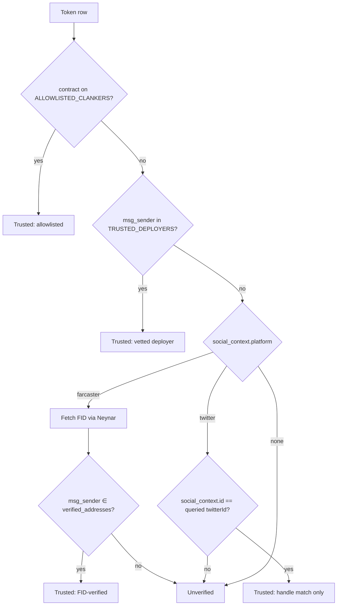

Anyone can deploy a Clanker token and attach any `social_context` to it, such as a Farcaster FID or an X (Twitter) handle. This page explains how clanker.world decides whether that claimed creator is real, and how you can run the same checks with the public [`GET /api/search-creator`](/api-reference/public/creators) endpoint.

## Why it matters

The `social_context` in a deployment is **not authenticated**. It's metadata the deployer chose to embed. A token row from `/api/search-creator` looks like this:

```json
{
  "contract_address": "0xabc...",
  "msg_sender": "0xdeadbeef...",
  "social_context": {
    "platform": "farcaster",
    "id": "12345"
  },
  "trustStatus": {
    "isTrustedDeployer": false,
    "isTrustedClanker": false,
    "fidMatchesDeployer": true,
    "verifiedAddresses": ["0xdeadbeef..."]
  }
}
```

It holds two separate identities:

* **`msg_sender`**: the wallet or contract that sent the deployment transaction. Transaction records prove it.
* **`social_context`**: a free-form `{ platform, id }` field embedded in the deployment. The deployer might not control that account.

A malicious deployer can claim any FID. The trust check answers one question: **does the wallet that deployed the token belong to the claimed social account?**

## How it works

clanker.world checks four trust signals in order. The first one that matches decides the result.

### 1. Allowlisted Clanker (`isTrustedClanker`)

The token's contract address is on an allowlist verified out of band, for example tokens deployed through Clanker and v3 presale token addresses. This signal overrides all others.

### 2. Trusted deployer (`isTrustedDeployer`)

`msg_sender` is on the list of deployers vetted by Clanker or its partners. These are the historical `TRUSTED_DEPLOYERS`. The list can change.

```
// TRUSTED_DEPLOYERS
  '0x2112b8456AC07c15fA31ddf3Bf713E77716fF3F9',
  '0xB2C90e2bB032349e7bEc82B37Cdcc93b6B91036a',
  '0x8da62A828b0D9f1B33F75652605e12ee4E5e4F06',
  '0x002F07B0D63e8ac14F8ef6B73Ccd8caF1FeF074c',
  '0xC204af95b0307162118f7Bc36a91c9717490AB69',
  '0xd9aCd656A5f1B519C9E76a2A6092265A74186e58',
  '0xdd6494902709C8D7DfFf3daca21cF067271f22F8',
  '0xdc7D0Ea3B64E0c74488faF6B2BDc927B875Cd3f2',
  '0x21c78a0350fa50e7c79c761003e33c0c7f440185',
  '0x5e2b5027742ae08c1a018144e31f101f24dc9824',
  '0x72469D86A92f5A9E975fE371a66015E667ab288f',
  '0x8865910d6ca985782Dc9CC521d23a10100fC800B',
  '0xe0c959eedcfd004952441ea4fb4b8f5af424e74b',
  '0x24D514Bc8eF5649A367d9c209b3AF16b0f177026',
  '0x9844050f249604F4485aeD2fC51BAAb3DBe78411',
  '0x26D0A510553C209a584E01Bd4551bDbe38151Fd4', // bracky deployer
  '0xBD01E8106a169687C8572672c8900760E5BA170f', // AutoBoy deployer
```

### 3. Farcaster FID match (`fidMatchesDeployer`)

For a Farcaster token, clanker.world looks up the FID's `verified_addresses.eth_addresses` through Neynar and checks:

> `msg_sender ∈ verifiedAddresses`

A match means the same person controls both the Farcaster account and the deploying wallet.

### 4. X (Twitter) context match

For an X token, clanker.world checks that `social_context.id` matches the queried X user ID. This is weaker than the Farcaster check, because X offers no on-chain proof.

### The full flow



## Check with the API

```bash
curl "https://www.clanker.world/api/search-creator?q=dish"
```

Each entry in `tokens` includes `trustStatus`:

| Field                | Type       | Description                                                          |
| -------------------- | ---------- | -------------------------------------------------------------------- |
| `isTrustedClanker`   | `boolean`  | The contract is on the allowlist.                                    |
| `isTrustedDeployer`  | `boolean`  | `msg_sender` is a vetted deployer.                                   |
| `fidMatchesDeployer` | `boolean`  | `msg_sender` is one of the FID's verified addresses (or an X match). |
| `verifiedAddresses`  | `string[]` | The Farcaster verified addresses used in the check.                  |

To get only verified results, add `trustedOnly=true`:

```bash
curl "https://www.clanker.world/api/search-creator?q=alice&trustedOnly=true"
```

This returns tokens where at least one of `isTrustedClanker`, `isTrustedDeployer` or `fidMatchesDeployer` is `true`.

## Check a single token yourself

1. Get the token's `msg_sender`, `contract_address` and `social_context`.
2. Accept it if `contract_address` is allowlisted.
3. Accept it if `msg_sender` is a trusted deployer.
4. For Farcaster context, look up the FID's user on Neynar and compare `msg_sender` with its `verified_addresses`. A match proves ownership.
5. For X context, confirm that the user ID matches `social_context.id`.

The Farcaster check in TypeScript:

```ts
async function isFarcasterVerifiedDeploy({
  msgSender,
  socialContext,
}: {
  msgSender: string;
  socialContext: { platform: 'farcaster'; id: string };
}) {
  const fid = Number(socialContext.id);
  if (!fid) return false;

  const res = await fetch(
    `https://api.neynar.com/v2/farcaster/user/bulk?fids=${fid}`,
    { headers: { 'x-api-key': process.env.NEYNAR_API_KEY! } },
  );
  const { users } = await res.json();
  const verified: string[] = users?.[0]?.verified_addresses?.eth_addresses ?? [];

  return verified.some((addr) => addr.toLowerCase() === msgSender.toLowerCase());
}
```

## What the trust check doesn't prove

* It does **not** say anything about the token's economic intent or value.
* A `false` result does **not** mean the token is a fraud.
* An X match is weaker than a Farcaster match. For an X deploy, open its deployment context to see the post that triggered it, and check the X account for impersonation.

If your app shows the trust status, show standard disclaimers next to it: tokens are speculative, users should do their own research, and this is not financial advice.

## Show your Farcaster account as creator

Deploy with a wallet that is a verified address on your Farcaster account. You can deploy by replying to @clanker in the Farcaster feed, by preclanking on the deploy page, or by calling `deployToken` from the deploy page or the SDK. To add a verified address to your Farcaster profile, go to **Settings ⇒ Verified Addresses**.
